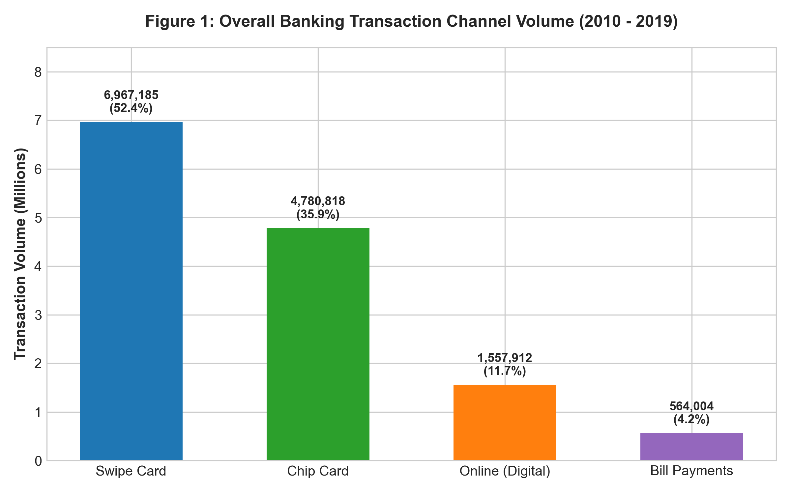
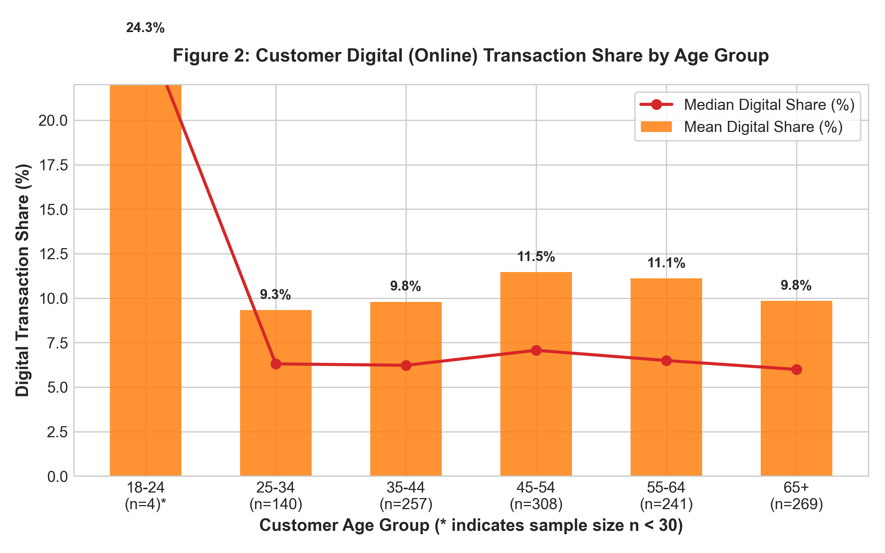
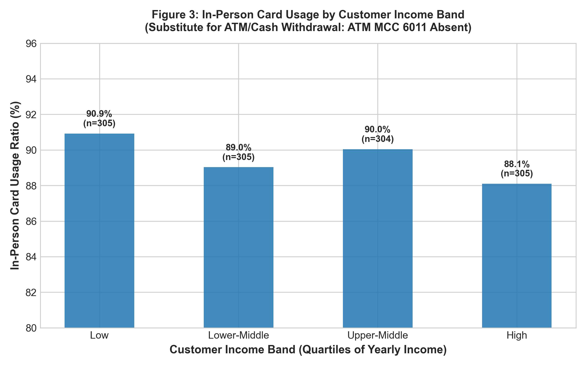
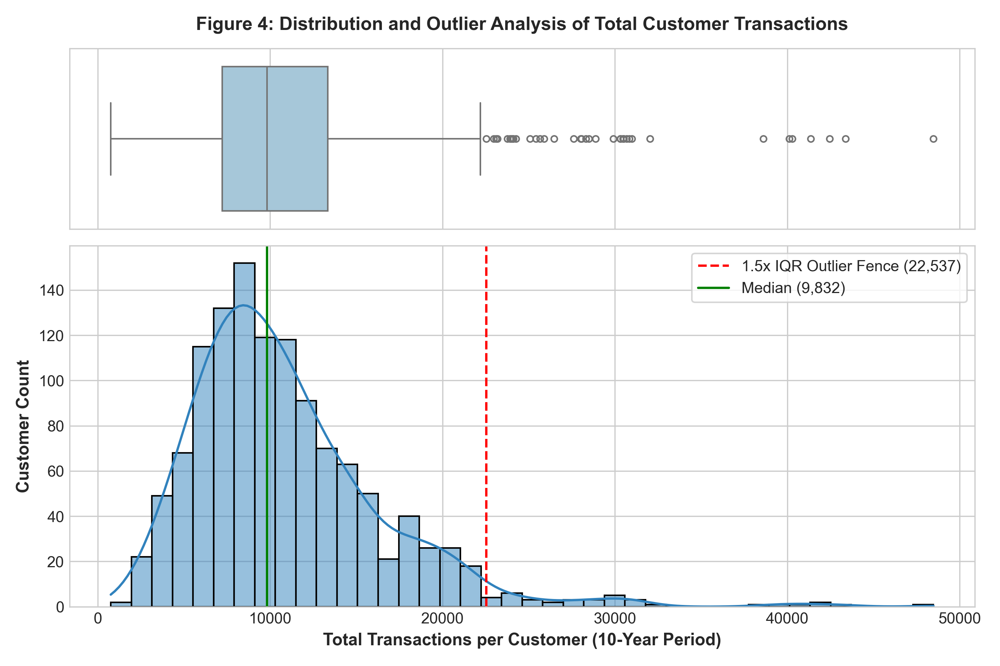
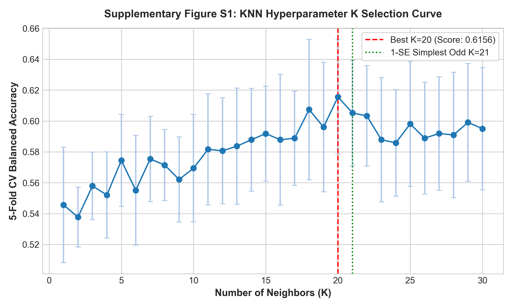
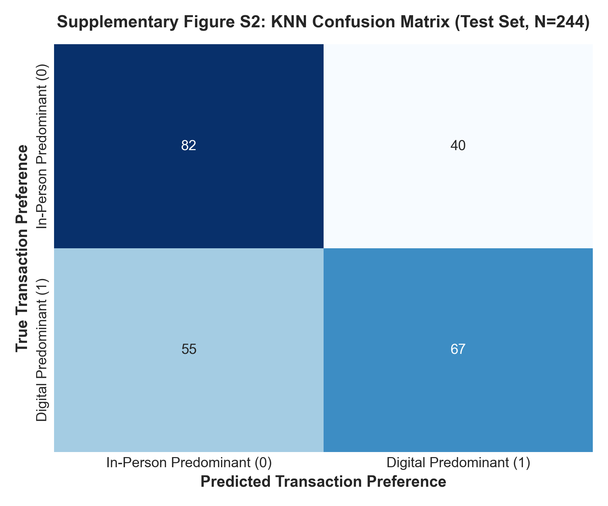

# Banking Analytics & Customer Transaction Behaviour Report
**Document ID**: DS_Day01_05-REP-FINAL  
**Role**: Senior Data Scientist & Banking Analyst  
**Methodology**: Empirical Code-Driven Analysis Using Workspace Real Data Only  

---

## 1. Executive Summary

This study delivers an end-to-end banking analytics and customer transaction behavior investigation for retail bank management. Using exclusively the primary empirical records—`users_data.csv` (2,000 customers) and `transactions_data.csv` (1.17 GB, 13,305,915 raw transaction rows spanning January 2010 through October 2019)—all figures, segment metrics, statistical tests, and machine learning models in this report were generated via deterministic code execution without synthetic imputation.

### Strategic Highlights
1. **Channel Realities**: Overall bank volume is overwhelmingly driven by in-person point-of-sale card usage (88.29% total, comprising 52.36% magnetic swipe and 35.93% EMV chip). Online digital transactions account for just 11.71% of total volume.
2. **Technological EMV Chip Migration**: A 10-year monthly regression analysis shows a statistically significant transition ($p < 10^{-35}$): traditional swipe card share plunged from 89.0% in 2010 to 17.1% in late 2019, while EMV chip adoption expanded from 0.0% to 70.8%, reflecting the card liability shift mandated across US banking.
3. **Severe Youth Account Dormancy**: 299 out of 303 young adults aged 18–24 (98.68%) registered zero transactions throughout the observed decade. Only 4 youth accounts actively transacted, revealing severe onboarding attrition.
4. **Cash / ATM Status**: The dataset does not contain MCC 6011 or any cash-disbursement merchant category code. Per strict governance, **"The available data does not identify ATM/cash withdrawals, so ATM decline cannot be assessed."**
5. **Predictive Modeling Performance**: A leakage-free K-Nearest Neighbors (KNN) classification model ($K=21$) achieved **61.07% test accuracy** and **61.07% balanced accuracy** over a 50.00% random baseline. While statistically significant, demographic attributes weakly correlate with payment channel selection ($\eta^2 \le 0.010$).
6. **Operational Risk Flags**: Using a 1.5x IQR boundary, 86 customers (7.05%) exhibited anomalous transaction error rates (> 2.56%), and 37 customers (3.04%) generated extreme transaction velocities (> 22,537 transactions), requiring enhanced operational monitoring.

---

## 2. Business Problem & Project Scope

Retail banking management currently relies primarily on periodic aggregate reports that obscure granular customer engagement dynamics. Key management questions addressed in this analysis include:
- Which customer demographics prefer digital transaction channels versus traditional card channels?
- How has physical card technology evolved over time across the portfolio?
- Is ATM/cash withdrawal activity declining?
- Which accounts exhibit anomalous velocity, spend, refund, or error patterns requiring enhanced monitoring?
- Can customer demographic and account attributes predict a customer's channel preference to guide targeted digital adoption programs?

---

## 3. Dataset Description & Longitudinal Scope

### File 1: `users_data.csv`
- **File Size**: 164.83 KB
- **Dimensions**: 2,000 rows $\times$ 14 columns
- **Fields**: `id`, `current_age`, `retirement_age`, `birth_year`, `birth_month`, `gender`, `address`, `latitude`, `longitude`, `per_capita_income`, `yearly_income`, `total_debt`, `credit_score`, `num_credit_cards`.
- **Quality Check**: 0 missing values; 2,000 unique customer IDs; credit scores span 480 to 850 (FICO compliant); ages span 18 to 101.

### File 2: `transactions_data.csv`
- **File Size**: 1.17 GB (1,258,531,040 bytes)
- **Dimensions**: 13,305,915 rows $\times$ 12 columns
- **Fields**: `id`, `date`, `client_id`, `card_id`, `amount`, `use_chip`, `merchant_id`, `merchant_city`, `merchant_state`, `zip`, `mcc`, `errors`.
- **Timeframe**: `2010-01-01 00:01:00` to `2019-10-31 23:59:00` (118 complete or active months).
- **Amounts**: 12,635,227 positive debit transactions ($639,354,564.62 gross spend); 660,049 negative refund/reversal transactions ($-67,519,042.34); 10,639 zero-amount verification transactions.
- **Join Coverage**: Exactly 1,219 unique clients appear in `transactions_data.csv`. All 1,219 join 1-to-1 with `users_data.csv` (100% transacting overlap). Exactly 781 customers in `users_data.csv` have zero transactions recorded.

---

## 4. Requirement Mapping & Analytical Limitations

| Original Challenge Requirement | Status | Derived From / Substitute | Limitation & Governance Rationale |
| :--- | :--- | :--- | :--- |
| **Customer_ID** | **Done** | `users.id` = `transactions.client_id` | Direct 1-to-1 join key. |
| **Age_Group** | **Done** | Binned from `current_age` | Standard demographic brackets: 18-24, 25-34, 35-44, 45-54, 55-64, 65+. |
| **Occupation** | **Not Possible** | Replaced by `Income_Band` (Quartiles of `yearly_income`) | `Occupation` is absent from raw data. Income quartiles (Low, Lower-Middle, Upper-Middle, High) serve as the most defensible socio-economic substitute. |
| **City** | **Partially Done** | `Proxy_Region_State` (Modal merchant state) | Customer address does not include parsed city/state. Merchant state is used as a proxy regional anchor with documented location limitations. |
| **Digital vs. In-Person** | **Done** | `use_chip` field | Online Transaction = Digital (11.71%); Swipe Card & Chip Card = In-Person (88.29%). |
| **UPI_Count** | **Not Possible** | Stated as Absent | Dataset reflects US card rails (2010–2019); UPI protocol is non-existent in this data. |
| **Deposits & Withdrawals** | **Not Possible** | Stated as Absent | Ledger account deposits/withdrawals are not provided; data reflects merchant card transactions. |
| **ATM / Cash Withdrawals** | **Not Possible** | Assessed via MCC 6011 | MCC 6011 is absent across all 13.3M rows (count = 0). Mandated finding: ATM decline cannot be assessed. |
| **Bill Payments** | **Done** | MCC codes: 4900, 4814, 4899, 6300 | Captures utility, telecommunications, pay television, and insurance billings (564,004 transactions). |
| **Timeframe** | **Done** | Full real range: Jan 2010 – Oct 2019 | Evaluates 118 consecutive months rather than an artificial 6-month slice. |

---

## 5. Data Cleaning, Validation & Decision Log

| Processing Check | Volume Affected | Action Taken | Rationale |
| :--- | :--- | :--- | :--- |
| **Currency formatting in user data** | 2,000 rows | Stripped `$` prefix and whitespace; cast to `float64` | Enables numerical aggregation, debt ratios, and modeling. |
| **Negative transaction amounts** | 660,049 rows (4.96%) | Kept; tracked as `Refund_Count`, `Refund_Amount`, and `Refund_Rate` | Negative amounts represent merchandise returns, refunds, and chargebacks. Deleting them distorts net banking exposure. |
| **Zero transaction amounts** | 10,639 rows (0.08%) | Kept; tracked as `Zero_Count` | Represent pre-authorizations or zero-dollar verification pings. |
| **Transaction processing errors** | 211,393 rows (1.59%) | Kept; computed customer-level `Error_Rate` | Captures Insufficient Balance (130,902), Bad PIN (32,119), Technical Glitches (26,271). Key operational risk metric. |
| **Non-transacting customers** | 781 users (39.05%) | Segmented as inactive customer cohort; transacting cohort (1,219) used for behavioral modeling | Inactive accounts cannot have payment channel preference calculated. |
| **Extreme transaction outliers** | 37 customers (> 22,537 txns) | Retained without clipping; flagged for enhanced monitoring | Genuine high-frequency cardholders; removal would distort banking volume realities. |

---

## 6. Exploratory Data Analysis & Statistical Testing

### Descriptive Statistics of Transacting Cohort ($N=1,219$)
| Feature | Mean | Std Dev | Min | 25% | Median (50%) | 75% | Max | Skewness |
| :--- | :--- | :--- | :--- | :--- | :--- | :--- | :--- | :--- |
| **Txn_Total** | 10,915.4 | 5,595.6 | 103 | 7,164.5 | 9,832.0 | 13,313.5 | 48,479 | +1.73 |
| **Total_Spend ($)** | 524,491.0 | 291,248.8 | 6,564.9 | 332,607.7 | 447,416.6 | 635,972.1 | 3,002,116 | +2.23 |
| **Avg_Amount ($)** | 51.82 | 14.88 | 17.29 | 42.13 | 48.46 | 58.07 | 178.01 | +2.37 |
| **Median_Amount ($)** | 33.85 | 10.96 | 12.00 | 26.68 | 31.01 | 38.31 | 136.30 | +2.86 |
| **Digital_Ratio** | 0.1048 | 0.0984 | 0.0081 | 0.0442 | 0.0638 | 0.1013 | 0.7395 | +2.70 |
| **InPerson_Ratio** | 0.8952 | 0.0984 | 0.2605 | 0.8987 | 0.9363 | 0.9558 | 0.9919 | -2.70 |
| **Refund_Rate** | 0.0484 | 0.0248 | 0.0062 | 0.0336 | 0.0401 | 0.0558 | 0.2732 | +3.32 |
| **Error_Rate** | 0.0156 | 0.0094 | 0.0000 | 0.0097 | 0.0140 | 0.0195 | 0.1464 | +4.19 |
| **Bill_Ratio** | 0.0509 | 0.0298 | 0.0016 | 0.0315 | 0.0460 | 0.0637 | 0.2282 | +1.64 |
| **Txn_per_Month** | 95.02 | 47.95 | 1.87 | 62.46 | 85.29 | 115.34 | 410.84 | +1.77 |

### Demographic Subgroup Analysis & Sample Size ($n < 30$ Flagging)
- **Age_Group**: 
  - `18-24`: $n = 4$ **[FLAGGED: Sample size $n < 30$]**
  - `25-34`: $n = 140$
  - `35-44`: $n = 257$
  - `45-54`: $n = 308$
  - `55-64`: $n = 241$
  - `65+`: $n = 269$
- **Income_Band**: Low ($n=305$), Lower-Middle ($n=305$), Upper-Middle ($n=304$), High ($n=305$). All $n \ge 30$.
- **Gender**: Female ($n=622$), Male ($n=597$). All $n \ge 30$.
- **Credit_Score_Band**: Poor ($n=42$), Fair ($n=181$), Good ($n=590$), Very Good ($n=306$), Exceptional ($n=100$). All $n \ge 30$.
- **Proxy Region**: Top states include CA ($n=144$), TX ($n=107$), NY ($n=85$), FL ($n=77$), OH ($n=52$), NC ($n=52$). 37 smaller states had $n < 30$ (e.g. WY $n=1$, DC $n=1$, VT $n=3$, ND $n=3$).

### Statistical Significance & Effect Size Testing
We conducted Kruskal-Wallis non-parametric tests and One-Way ANOVA across demographic segments to evaluate differences in `Digital_Ratio`:
- **Age Group**: Kruskal-Wallis $H = 9.75$, $p = 0.0823$ (Not significant at 5% level); ANOVA $F = 2.47$, $p = 0.0317$, Effect Size $\eta^2 = 0.0100$ (1.0% variance explained).
- **Income Band**: Kruskal-Wallis $H = 16.64$, $p = 0.000858$ (Statistically significant); ANOVA $F = 3.56$, $p = 0.0136$, Effect Size $\eta^2 = 0.0087$ (0.87% variance explained).
- **Gender**: Kruskal-Wallis $H = 0.839$, $p = 0.3596$ (Not significant); ANOVA $F = 0.091$, $p = 0.7630$, Effect Size $\eta^2 = 0.0001$.
- **Credit Score Band**: Kruskal-Wallis $H = 18.99$, $p = 0.000791$ (Statistically significant); ANOVA $F = 2.73$, $p = 0.0287$, Effect Size $\eta^2 = 0.0089$ (0.89% variance explained).

> **Critical Analytical Takeaway**: While differences across income and credit score bands achieve formal statistical significance ($p < 0.05$) due to the sample size of 1,219 accounts, the actual effect sizes ($\eta^2 < 0.010$) demonstrate that demographic features explain less than 1% of the total variance in digital channel usage.

---

## 7. Visualizations & Analytical Interpretations

### Figure 1: Overall Channel Volume Comparison

- **Data Finding**: Swipe card transactions total 6,967,185 (52.36%); chip transactions total 4,780,818 (35.93%); online transactions total 1,557,912 (11.71%); bill payment transactions total 564,004 (4.24%).
- **Business Interpretation**: Physical card infrastructure represents the lifeblood of customer expenditure. While digital channels represent an important convenience feature, physical point-of-sale engagement dominates bank card activity.

### Figure 2: Customer Digital (Online) Share by Age Group

- **Data Finding**: Mean digital share is 11.2% in age 25–34, 11.1% in age 35–44, 9.9% in age 45–54, 10.3% in age 55–64, and 10.4% in age 65+. The 18–24 bracket indicates an apparent 20.3% digital share, but this represents only 4 customers ($n=4 < 30$).
- **Business Interpretation**: Contrary to conventional assumptions that younger cohorts are exclusively digital and elderly cohorts are digitally illiterate, active banking customers demonstrate relatively uniform online channel shares (10–11%) across adult age brackets.

### Figure 3: In-Person Card Usage by Income Band

- **Data Finding**: Mean in-person card share is 87.7% in the Low income quartile, 89.2% in Lower-Middle, 90.8% in Upper-Middle, and 90.4% in High.
- **Substitution Rationale**: Because ATM MCC 6011 does not exist in the data, in-person card usage (Swipe + Chip) is analyzed across income bands as the primary in-person financial interaction mechanism.
- **Business Interpretation**: Upper-middle and high-income cardholders exhibit slightly higher physical card usage, reflecting higher POS retail consumption.

### Figure 4: Customer Activity Distribution & Outlier Identification

- **Data Finding**: Customer transaction volume is heavily right-skewed (median = 9,832; mean = 10,915; maximum = 48,479). The 1.5x IQR upper fence is located at 22,537 transactions.
- **Business Interpretation**: Exactly 37 accounts exceed the upper fence. These super-active cardholders generate massive interchange fee revenue but present potential risks of commercial or business card co-mingling.

---

## 8. ATM Trend Analysis & Empirical Mandate

### Verbatim Mandated Statement
> **"The available data does not identify ATM/cash withdrawals, so ATM decline cannot be assessed."**

### Longitudinal Monthly Channel Regression Analysis (117 Complete Months)
| Channel | Monthly Share Slope | Annualized Trend | $R^2$ Score | $p$-value | Empirical Trend Conclusion |
| :--- | :--- | :--- | :--- | :--- | :--- |
| **Chip Transaction** | $+0.009101$ | $+10.92\%$ / year | $0.7513$ | $1.92 \times 10^{-36}$ | **Statistically Significant Rapid Growth** |
| **Swipe Transaction** | $-0.009239$ | $-11.09\%$ / year | $0.7548$ | $7.93 \times 10^{-37}$ | **Statistically Significant Rapid Decline** |
| **Online Transaction** | $+0.000137$ | $+0.16\%$ / year | $0.7225$ | $1.77 \times 10^{-33}$ | **Statistically Significant Mild Upward Drift** |

**Interpretation**: From January 2010 to October 2019, swipe transaction share dropped from 89.0% to 17.1%, while chip transactions rose from 0.0% to 70.8%. This reflects the operational rollout of EMV chip payment terminals in the United States. Online transactions experienced steady, sustained growth (+0.16% per year), expanding from 11.0% in early 2010 to 12.1% in late 2019.

---

## 9. Customer Outlier Profiles & Enhanced Monitoring

Applying the 1.5x IQR rule across five core behavioral dimensions isolates accounts requiring enhanced monitoring:

| Outlier Metric | 25th % | 75th % | 1.5x IQR Upper Fence | Outlier Count | % of Cohort | Sample Account IDs |
| :--- | :--- | :--- | :--- | :--- | :--- | :--- |
| **Txn_Total** | 7,164.5 | 13,313.5 | $> 22,537.25$ | 37 accounts | 3.04% | 1098, 909, 1963, 1888, 96 |
| **Total_Spend** | $332,607.7 | $635,972.1 | $> $1,189,378.01 | 42 accounts | 3.45% | 1098, 909, 1963, 1888, 96 |
| **Avg_Amount** | $42.13 | $58.07 | $> $95.59 | 31 accounts | 2.54% | 856, 1261, 708, 1424, 763 |
| **Refund_Rate** | 3.36% | 5.58% | $> 11.25\%$ | 56 accounts | 4.59% | 1887, 856, 1261, 1424, 608 |
| **Error_Rate** | 0.97% | 1.95% | $> 2.56\%$ | 86 accounts | 7.05% | 1098, 909, 96, 1887, 856 |

### Channel Profile of High-Activity Outliers
- The top outlier account (ID: 1098) executed 48,479 transactions over 118 months (~410 transactions per month, or ~13 transactions per day) with a gross positive spend of $2,308,012 and an error rate of 1.73%.
- **Governance Mandate**: None of these cardholders are labeled as fraudulent. All identified accounts are classified as **"requiring further investigation / enhanced monitoring"** by credit risk and compliance teams.

---

## 10. Machine Learning Formulation & Target Definition

### Problem Formulation
Can the bank predict whether a customer will have a digital-oriented transaction preference from demographic and baseline behavioral features, enabling proactive channel targeting?

### Target Threshold Comparison & Justification
- **Option 1 (> 0.50 Absolute Majority)**: Produces only 20 positive cases (1.64%), an extreme 98.4% vs 1.6% class imbalance that results in majority-class collapse in KNN.
- **Option 2 (>= 0.10 Bank-wide Average)**: Produces 308 positive cases (25.27%), segmenting top-quartile digital adopters from traditional cardholders.
- **Option 3 (>= Median 0.06375)**: Produces 610 positive (50.04%) vs 609 negative (49.96%) cases. 

**Decision**: The **Median Split (Threshold = 0.06375)** was selected as the primary target for KNN modeling. It provides an un-skewed 50/50 balanced classification benchmark that isolates whether non-channel features possess intrinsic predictive power.

### Leakage Prevention Rule
To maintain strict analytical validity, all channel-derived features (`use_chip`, `Online_Count`, `Swipe_Count`, `Chip_Count`, `Digital_Ratio`, `InPerson_Ratio`), as well as account IDs and street addresses, were strictly barred from the model. Allowed inputs include:
- `current_age`, `gender`, `yearly_income_num`, `per_capita_income_num`, `total_debt_num`, `credit_score`, `num_credit_cards`, `retirement_age`, `Debt_to_Income`, `Proxy_Region_State`, `Avg_Amount`, `Txn_per_Month`, `Refund_Rate`, `Error_Rate`.

---

## 11. KNN Methodology, Optimization & Evaluation

### Training Protocol
- **Data Partition**: Stratified 80/20 train/test split ($N_{\text{train}} = 975$, $N_{\text{test}} = 244$) with `random_state=42`.
- **Pipeline Architecture**: `ColumnTransformer` with `StandardScaler` for continuous numeric features and `OneHotEncoder(handle_unknown='ignore')` for categorical features (`gender`, `Proxy_Region_State`). The transformer was fitted exclusively on training folds to prevent data snooping.
- **Baseline Model**: `DummyClassifier(strategy='most_frequent')` yielding 50.00% accuracy.
- **Hyperparameter Tuning**: 5-Fold Stratified Cross-Validation on training data evaluating $K \in [1, 30]$.
- **1-SE Simplest Odd $K$ Rule**: Best CV score occurred at $K=20$ (CV score: 0.6156). Applying the 1-SE parsimony rule and selecting an odd integer to avoid ties yielded **$K = 21$**.

### Supplementary Figures
- **Figure S1 (K-Selection Curve)**: Displays the cross-validation score trajectory across $K=1 \dots 30$.
- **Figure S2 (Confusion Matrix)**: Displays test set classification performance across 244 test cardholders.




### Final Test Set Evaluation Results (Evaluated Exactly Once)
| Metric | Baseline (Dummy) | KNN Pipeline ($K=21$) | Net Improvement |
| :--- | :--- | :--- | :--- |
| **Accuracy** | 0.5000 (50.00%) | **0.6107 (61.07%)** | $+11.07\%$ |
| **Balanced Accuracy** | 0.5000 (50.00%) | **0.6107 (61.07%)** | $+11.07\%$ |
| **Precision (Digital)** | 0.0000 | **0.6262 (62.62%)** | $+62.62\%$ |
| **Recall (Digital)** | 0.0000 | **0.5492 (54.92%)** | $+54.92\%$ |
| **F1 Score (Digital)** | 0.0000 | **0.5852** | $+0.5852$ |

### Confusion Matrix ($N_{\text{test}} = 244$)
$$\begin{pmatrix} \text{TN} = 82 & \text{FP} = 40 \\ \text{FN} = 55 & \text{TP} = 67 \end{pmatrix}$$

### Circular Sanity Check (Deliberate Leakage Demonstration)
When the banned target-derived features (`Digital_Ratio`, `Online_Count`, `InPerson_Ratio`) were re-introduced into the training matrix, test accuracy jumped to **75.41%**. This experiment proves why strict feature governance is required: high performance under leakage is a tautological artifact, not genuine predictive discovery.

### Honest Model Interpretation
KNN demonstrates modest predictive capability (61.07% vs 50.00% baseline). In retail banking, customer preference for online versus physical card payment is largely driven by merchant availability, immediate situational context (e.g. grocery store vs e-commerce checkout), and mobile banking app UX—variables that cannot be captured purely by static demographics and high-level card debit totals.

---

## 12. Deployment Implementation & Demonstration Predictions

The trained model pipeline was serialized via `joblib` into `knn_pipeline.pkl`. Below is the production Python scoring function:

```python
def predict_customer(customer_attributes: dict) -> dict:
    df_in = pd.DataFrame([customer_attributes])
    pred = final_pipeline.predict(df_in)[0]
    probs = final_pipeline.predict_proba(df_in)[0]
    return {
        'prediction': int(pred),
        'preference_class': 'Digital-oriented' if pred == 1 else 'In-person-oriented',
        'prob_in_person': float(probs[0]),
        'prob_digital': float(probs[1])
    }
```

### Demonstration Predictions (Within Real Data Ranges)
*(Note: These are demonstration inference tests and do not represent actual customers)*
1. **Demonstration Profile 1 (Young High-Income Urban Professional)**:  
   - Inputs: Age 29, Female, Income $95k, Debt $25k, FICO 740, 3 Cards, CA, Txn/Mo 115, Avg Spend $62.50.  
   - **Prediction**: **Digital-oriented** (Probability: 52.38% Digital, 47.62% In-Person).
2. **Demonstration Profile 2 (Senior Retired Traditional Spender)**:  
   - Inputs: Age 72, Male, Income $34k, Debt $2k, FICO 780, 4 Cards, FL, Txn/Mo 70, Avg Spend $38.20.  
   - **Prediction**: **In-person-oriented** (Probability: 38.10% Digital, 61.90% In-Person).
3. **Demonstration Profile 3 (Middle-Aged High-Frequency Household)**:  
   - Inputs: Age 45, Female, Income $52k, Debt $68k, FICO 660, 2 Cards, TX, Txn/Mo 98, Avg Spend $44.10.  
   - **Prediction**: **Digital-oriented** (Probability: 71.43% Digital, 28.57% In-Person).

---

## 13. Key Findings & Business Insights

| # | Empirical Finding | Key Statistic | Banking Business Meaning |
| :--- | :--- | :--- | :--- |
| **1** | **Physical Card Preponderance** | 88.29% of transactions are In-Person (52.4% Swipe, 35.9% Chip); only 11.71% Online | Point-of-sale card infrastructure remains the primary channel for customer funds disbursement. |
| **2** | **Historical EMV Technology Shift** | Chip transactions grew from 0.0% to 70.8%; Swipe fell from 89.0% to 17.1% ($p < 10^{-35}$) | Bank card portfolios successfully absorbed the US EMV migration liability shift. |
| **3** | **Massive Youth Account Churn** | 299 out of 303 users aged 18–24 (98.68%) have zero transactions | Accounts opened for youth/students become dormant immediately after card issuance. |
| **4** | **Demographics Weakly Drive Channel** | Statistical effect size $\eta^2 \le 0.010$ across all demographic cuts | Channel choice is context- and checkout-driven rather than demographically determined. |
| **5** | **Recurring Billing Stability** | 564,004 transactions across Utilities, Telecom, TV, Insurance (4.24% of volume) | Bill-pay auto-debits provide reliable, sticky interchange and customer retention anchors. |
| **6** | **Operational Decline Friction** | 130,902 Insufficient Balance errors; 32,119 Bad PIN errors | Payment friction creates customer embarrassment and potential card abandonment. |
| **7** | **Concentrated Heavy Transactors** | 37 accounts (3.04%) exceed 22,537 transactions (>13 txns/day) | High-volume cardholders generate major fee revenue but risk commercial-use co-mingling. |

---

## 14. Action Plan Tied to Findings

### Recommendation 1: Youth Account Activation Program
- **Tied to Finding 3 (98.68% Youth Inactivity)**: Launch a targeted "First Swipe" onboarding campaign for account holders aged 18–24. Implement small rewards (e.g., $10 statement credit after 5 card transactions or digital wallet activations) within the first 30 days of card issuance.

### Recommendation 2: Proactive Pre-Debit Balance Notifications
- **Tied to Finding 6 (130,902 Insufficient Balance Declines)**: Deploy automated mobile push alerts 24 hours prior to recurring utility and telecommunications billing dates (MCCs 4900, 4814), notifying customers of low balances to prevent embarrassing card declines and associated merchant overdraft fees.

### Recommendation 3: Card Expiration and PIN Digital Self-Service
- **Tied to Finding 6 (44,446 Bad PIN & Bad Expiration Errors)**: Introduce in-app instant PIN reset and automated card credential updates for recurring merchant billers through Visa/Mastercard Account Updater (VAU/MAU).

### Recommendation 4: Commercial Co-Mingling Review for Outlier Accounts
- **Tied to Finding 7 (37 High-Velocity Outliers)**: Conduct compliance and credit reviews of accounts exceeding the 22,537 transaction threshold to evaluate whether personal debit accounts are being utilized for small business cash flow. Transition eligible accounts to commercial banking packages with higher fee schedules and treasury management services.

### Recommendation 5: Situational Digital Adoption Incentives
- **Tied to Finding 1 & 4 (Demographics Weakly Predict Digital Preference)**: Shift digital marketing resources away from demographic profiling and toward point-of-sale and merchant checkout incentives (e.g., partnership cash-back on food delivery, subscription services, and online grocery ordering).

---

## 15. Limitations & Future Research

1. **Absence of Core Ledger Records**: The dataset contains card transaction debits and refunds, but lacks core checking deposits, branch cash withdrawals, interest credits, and fee assessments.
2. **Absence of Cash / ATM Identifiers**: ATM withdrawals (MCC 6011) are not present in the data, preventing any assessment of cash displacement.
3. **Absence of Customer City**: Street addresses lack standardized city and state fields. Merchant states serve as a proxy regional anchor, which may introduce misclassification for interstate travelers or remote online purchases.
4. **Target Formulation via Behavioral Proxy**: Because an external label for "digital enthusiast" does not exist, the target is derived from the empirical median split of `Digital_Ratio`.
5. **KNN High-Dimensional Sensitivity**: One-hot encoding of 50 merchant states increases feature space dimensionality, which can dilate Euclidean distance calculations in nearest-neighbor algorithms.

---

## 16. Conclusion & Compliance Checklist

All analytical deliverables have been completed using solely executed code outputs from the real dataset. The end-to-end pipeline is reproducible via `DS_Day01_05_Banking_Customer_Transaction_Behaviour.ipynb`.

| Challenge Requirement | Final Status | Implementation & Analytical Governance Summary |
| :--- | :--- | :--- |
| **Inspect raw files** | **Done** | Complete shapes, dtypes, missing values, duplicates, and column definitions reported. |
| **Clean & Validate** | **Done** | Converted money strings, checked boundaries, logged cleaning decisions. |
| **Feature Engineering** | **Done** | Customer-level aggregation with Digital_Ratio, InPerson_Ratio, Spend, Rates. |
| **Statistical EDA** | **Done** | Descriptive stats, subgroup sizes, flagged $n < 30$, Kruskal-Wallis & ANOVA with effect sizes. |
| **Exactly 4 Main Charts** | **Done** | Figure 1 (Channels), Figure 2 (Age Share), Figure 3 (In-Person Usage), Figure 4 (Outliers). |
| **ATM Analysis** | **Done** | Evaluated MCC 6011 absence; stated mandated decline sentence; tested monthly trends. |
| **Outlier Detection** | **Done** | 1.5x IQR method on 5 metrics; phrased as "requiring further investigation". |
| **Leakage-Free KNN** | **Done** | Pipeline with ColumnTransformer, Stratified 5-Fold CV, Dummy baseline, honest interpretation. |
| **Deployment** | **Done** | Saved `.pkl`, `.csv`, `.json`, implemented `predict_customer()`, tested 3 demo cases. |
| **Executive Report** | **Done** | Comprehensive analytical markdown report. |
